  

  

  

## About Me

Developer passionate about building applications and analyzing data. I enjoy creating solutions from frontend to backend, and turning data into clear, practical insights that support better decisions.

## Tech Stack

<table>
  <tr>
    <td width="170"><b>Languages</b></td>
    <td>
      
      
      
      
      
      
      
      
    </td>
  </tr>
  <tr>
    <td width="170"><b>Data Analytics</b></td>
    <td>
      
      
      
      
    </td>
  </tr>
  <tr>
    <td width="170"><b>Data Visualization</b></td>
    <td>
      
      
      
      
      
    </td>
  </tr>
  <tr>
    <td width="170"><b>Machine Learning</b></td>
    <td>
      
    </td>
  </tr>
  <tr>
    <td width="170"><b>Backend</b></td>
    <td>
      
      
    </td>
  </tr>
  <tr>
    <td width="170"><b>Mobile</b></td>
    <td>
      
    </td>
  </tr>
  <tr>
    <td width="170"><b>Databases</b></td>
    <td>
      
      
    </td>
  </tr>
  <tr>
    <td width="170"><b>Design & Graphics</b></td>
    <td>
      
      
    </td>
  </tr>
  <tr>
    <td width="170"><b>Tools</b></td>
    <td>
      
      
      
      
      
    </td>
  </tr>
</table>

## Languages

🇸🇦 Arabic (native) · 🇬🇧 English (professional working proficiency)
